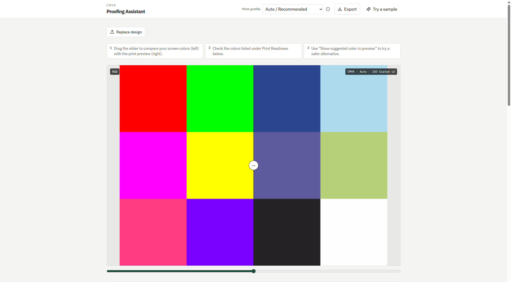
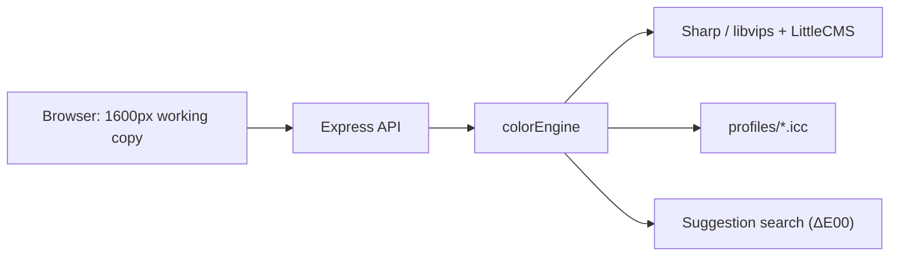

# CMYK Proofing Assistant

See how your RGB design is likely to look when printed in CMYK, find the colors that will shift, and get safer RGB alternatives before you send the file to print.

**Live:** https://cmyk-proofing-assistant.vercel.app



## What it does

1. **Upload** a PNG, JPG, WebP or SVG (or click **Try a sample**).
2. **Compare** your screen colors with a CMYK soft proof using a before/after slider.
3. **Pick a print profile**: FOGRA39, FOGRA51, GRACoL, SWOP or Japan Color (or keep Auto).
4. **Review the colors to watch.** Each one gets a plain-language summary ("Will print duller and darker"), the reason, and its color shift (ΔE00).
5. **Preview suggestions.** For colors that shift, the app searches for RGB alternatives that print closer to what you intended, and only suggests ones that actually improve the result.
6. **Export** the soft proof, an HTML color report, or a CMYK TIFF.

Soft proofing is an on-screen simulation. Final appearance depends on the printer, paper, ink, press conditions and ICC profile.

## Run it locally

Requires **Node.js 20 or newer** (`.nvmrc` pins 22).

```bash
git clone https://github.com/shivangpmr/cmyk-proofing-assistant.git
cd cmyk-proofing-assistant
npm install
npm run dev
```

- Web app: http://localhost:5173
- API: http://localhost:8787 (the web dev server proxies `/api` to it)

Other scripts:

| Command | What it does |
| --- | --- |
| `npm run build` | Builds the shared package, API and web app |
| `npm run dev:api` / `npm run dev:web` | Runs one side only |

## Deploy your own copy

[](https://vercel.com/new/clone?repository-url=https://github.com/shivangpmr/cmyk-proofing-assistant)

[`vercel.json`](vercel.json) builds the web app as static files and runs the Express API as one serverless function (`api/index.ts`) with the ICC profiles bundled.

Limits on Vercel's Hobby plan:

- Requests and responses are capped at about **4.5 MB**. The browser therefore sends a downscaled working copy (longest edge 1600 px) instead of your original file, and the proof comes back as a high-quality JPEG.
- The CMYK TIFF export uses that working copy, so it is not print resolution. Run the app locally for full-size TIFFs.

### Abuse protection

The API rate-limits POST requests to 30 per 5 minutes per IP, rejects non-image uploads and refuses images over 40 megapixels. The rate limiter keeps counts in memory, so each serverless instance counts separately. For a stronger limit on a public deployment, add a rule in your Vercel project under **Firewall → Rules**: match requests whose path starts with `/api/` and apply a rate limit (for example 30 requests per 5 minutes per IP). Rate-limit rule availability depends on your Vercel plan.

## How it works



- **Soft proof:** sRGB → CMYK through the selected ICC profile, then CMYK → sRGB for display (Sharp, perceptual intent).
- **Analysis:** clusters the image into up to 12 dominant colors and measures each one's shift with ΔE00. Under 3 is treated as safe, 3 to 8 as a minor shift and over 8 as significant ([`packages/shared/src/thresholds.ts`](packages/shared/src/thresholds.ts)).
- **Suggestions:** samples candidate RGB colors around the original in Lab space, soft-proofs them in one batch, and ranks them as Balanced, Closest and Safer.

```text
apps/web/         React + Vite + Tailwind UI
apps/api/         Express API and the color engine (apps/api/src/colorEngine)
packages/shared/  Types, profile registry, ΔE thresholds
profiles/         Bundled ICC profiles
api/index.ts      Vercel serverless entry
```

## ICC profiles

Six CMYK profiles are bundled in [`profiles/`](profiles/). They are **not** covered by this project's license; they belong to their owners and keep their own terms. See [`profiles/README.md`](profiles/README.md) for each file's source and for how to add your printer's profile.

## License

The source code is released under the [MIT License](LICENSE). The ICC profiles in `profiles/` are excluded (see above).
